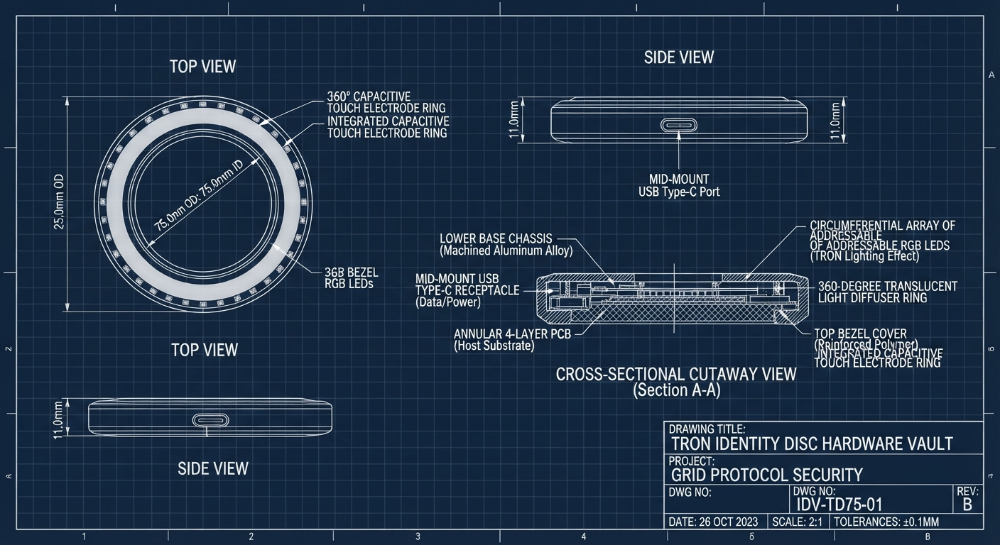
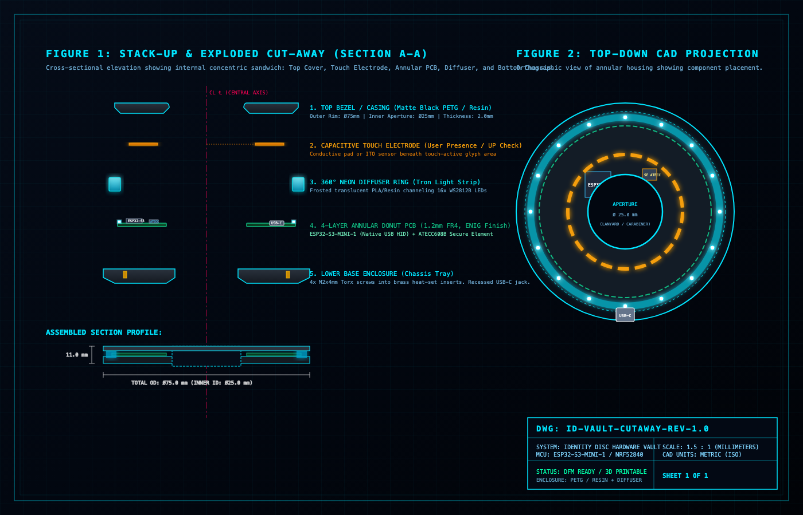

<div align="center">

```text
██╗██████╗     ██╗   ██╗ █████╗ ██╗   ██╗██╗  ████████╗
██║██╔══██╗    ██║   ██║██╔══██╗██║   ██║██║  ╚══██╔══╝
██║██║  ██║    ██║   ██║███████║██║   ██║██║     ██║   
██║██║  ██║    ╚██╗ ██╔╝██╔══██║██║   ██║██║     ██║   
██║██████╔╝     ╚████╔╝ ██║  ██║╚██████╔╝███████╗██║   
╚═╝╚═════╝       ╚═══╝  ╚═╝  ╚═╝ ╚═════╝ ╚══════╝╚═╝   
```

### **ZERO-TRUST DEVELOPER SECRET INJECTOR & HARDWARE IDENTITY VAULT**

[](https://www.rust-lang.org/)
[](https://github.com/bsommers)
[](#the-solution)
[](#performance-targets)

<p align="center">
  
</p>

<p align="center">
  <b>Developer secret injector and cloud bootstrap CLI enforcing zero-trust hardware key (FIDO2/U2F/YubiKey) and Passkey signature verification.</b><br>
  <i>Inspired by the TRON Identity Disc: your cryptographic essence, your immutable signature, and absolute control over every privileged execution.</i>
</p>

---

## 🛡️ The Skeptic's Defense: Isn't This Just Another Hardware Key?

> *"YubiKeys, Nitrokeys, and Apple Passkeys already exist. Why do we need Identity Disc Vault?"*

**A hardware key is merely a cryptographic peripheral. Identity Disc Vault is an end-to-end zero-trust execution runtime.**

Traditional hardware keys stop at authentication: they answer a cryptographic challenge and hand control back to existing tools. But those tools promptly **dump plaintext secrets into `.env` files, write `~/.aws/credentials` to disk, export tokens into shell histories, or paste them onto the clipboard.** 

The moment a secret touches disk, your $60 hardware key is rendered useless against infostealers, malicious dependencies, and compromised background processes.

```text
┌────────────────────────────────────────────────────────────────────────┐
│                        THE CRITICAL ARCHITECTURAL GAP                  │
├────────────────────────────────────────────────────────────────────────┤
│  TRADITIONAL TOOLING:                                                  │
│  [YubiKey] ──► Authenticates ──► [Password Mgr] ──► ❌ WRITES TO DISK   │
│                                                     (.env, ~/.aws, SH) │
│                                                                        │
│  IDENTITY DISC VAULT:                                                  │
│  [Hardware Touch / Passkey] ──► [idvault runtime] ──► 🛡️ ZERO-DISK RAM  │
│                                                     (Child memory only)│
└────────────────────────────────────────────────────────────────────────┘
```

### What Truly Stands Out About Identity Disc Vault:

1. **Guaranteed 0-Byte Disk Footprint**: Secrets are decrypted into kernel-locked memory (`mlock`, `MADV_DONTDUMP`) and injected directly into target child processes (`idvault exec -- terraform apply`) or anonymous memory pipes (`/dev/fd/X`). Plaintext secrets never touch storage, swap, or shell environments.
2. **Just-In-Time Proof-of-Presence**: Malicious background scripts and hijacked shells cannot silently exfiltrate credentials. Every privileged invocation requires an active physical touch (Touch ID, Windows Hello, or capacitive Disc tap).
3. **Hardware Independence ($0 Entry Barrier)**: Physical hardware tokens are completely optional. Every MacBook and modern PC has an Apple Secure Enclave or TPM. `idvault` treats OS-native Passkeys and physical FIDO2 keys as first-class cryptographic peers via WebAuthn PRF.
4. **Attested Cloud Bootstrap (Killing Static IAM Keys)**: Transforms short-lived hardware presence assertions directly into temporary AWS STS (`AssumeRoleWithWebIdentity`) and GCP Workload Identity Federation sessions, ending reliance on long-lived `AKIA...` keys.
5. **Open Physical Hardware Option**: For teams desiring physical security tokens, we provide open-source 3D CAD files (`.STL`/`.OBJ`) and an open BoM (~$15.30) for a 360° Neopixel telemetry Tron Disc with out-of-band visual state verification.

👉 *Read the full thesis: [docs/DEFENSE_OF_PROJECT.md](file:///Users/bill/src/research/systems-programming/indentity-disc-vault/docs/DEFENSE_OF_PROJECT.md)*

---

## 🛠️ Physical Realization & Hardware Architecture

We have engineered a realistic, open-source physical realization of the TRON Identity Disc as a 3D-printable FIDO2/WebAuthn PRF hardware security vault:

<p align="center">
  
  &nbsp;&nbsp;&nbsp;&nbsp;
  
</p>

- **Interactive 3D Models**: Production-ready [`.STL`](file:///Users/bill/src/research/systems-programming/indentity-disc-vault/hardware/cad/identity_disc_assembly.stl) and [`.OBJ`](file:///Users/bill/src/research/systems-programming/indentity-disc-vault/hardware/cad/identity_disc_assembly.obj) files for base chassis, top lid, and 360° light ring diffuser in [`hardware/cad/`](file:///Users/bill/src/research/systems-programming/indentity-disc-vault/hardware/cad/).
- **Bill of Materials (BoM)**: Complete prototype BOM (~$15.30 total cost) leveraging the ESP32-S3 (Native USB HID + Crypto), ATECC608B Secure Element, and 16x addressable LEDs in [`hardware/bom/BILL_OF_MATERIALS.md`](file:///Users/bill/src/research/systems-programming/indentity-disc-vault/hardware/bom/BILL_OF_MATERIALS.md).
- **Presence Verification**: Integrated capacitive touch electrode for FIDO2 User Presence (UP) checks.

---

</div>

## ⚡ The Problem Statement

Developer workstations and CI/CD runners represent the soft underbelly of modern software supply chains. The current state of secrets management is structurally vulnerable:

```text
┌─────────────────────────────────┐     ┌─────────────────────────────────┐
│     Current Developer Reality   │ vs  │    Sophisticated Attack Vector  │
│ (Plaintext .env, Shell Exports) │     │ (Infostealers, CI Compromises)  │
├─────────────────────────────────┤     ├─────────────────────────────────┤
│ ❌ Plaintext `.env` / `.aws`    │     │ ❌ Infostealer malware scanning │
│ ❌ Long-lived API tokens on disk│     │ ❌ Unattended shell exfiltration│
│ ❌ Persistent SSH & cloud keys  │     │ ❌ Accidental git commits       │
│ ❌ No presence / touch gating   │     │ ❌ Rogue dependency escalation  │
└─────────────────────────────────┘     └─────────────────────────────────┘
```

1. **Persistent Plaintext Secrets on Disk**: Developers routinely store high-privilege credentials (AWS access keys, production database passwords, Stripe/GitHub tokens) in plaintext dotfiles (`~/.aws/credentials`, `.env`, `.bashrc`). One malicious npm dependency or infostealer malware strain instantly harvests the entire fleet.
2. **Missing Proof-of-Presence Gating**: Once written to disk, credentials can be read repeatedly without any user knowledge or physical authorization. There is no cryptographic verification that the authorized human is actively sitting in front of the console during execution.
3. **Complex Cloud Bootstrapping Friction**: Developers bypass security policies because authenticating to cloud IAM roles (AWS STS, GCP Workload Identity, Vault) requires tedious token dances, encouraging users to fallback to long-lived static API keys.

---

## 💡 The Solution: Identity Disc Vault

**Identity Disc Vault (`idvault`)** eliminates permanent secrets from workstation disks entirely. Secrets are cryptographically bound to hardware security keys (FIDO2/YubiKey) or biometric Passkeys (Apple Touch ID / Windows Hello / TPM2), and injected ephemerally into child processes in-memory.

```text
 ┌────────────────────────────────────────────────────────────────────────┐
 │                      IDENTITY DISC VAULT ARCHITECTURE                  │
 └────────────────────────────────────────────────────────────────────────┘

                 Developer CLI / Script Execution
                                │
                                ▼
    ┌──────────────────────────────────────────────────────────────────┐
    │  idvault exec [--profile prod] -- ./deploy-service               │
    └───────────────────────────┬──────────────────────────────────────┘
                                │
                                ▼
    ┌──────────────────────────────────────────────────────────────────┐
    │  CRYPTOGRAPHIC IDENTITY ATTESTATION (Physical Presence Gate)     │
    │  • FIDO2 / CTAP2 Token (YubiKey Touch)                           │
    │  • Platform Passkey (Apple Touch ID / Secure Enclave / Win Hello)│
    │  • Signature challenge-response verification                     │
    └───────────────────────────┬──────────────────────────────────────┘
                                │ Verified User Presence
                                ▼
    ┌──────────────────────────────────────────────────────────────────┐
    │  ENVELOPE DECRYPTION & EPHEMERAL SECRET GENERATION               │
    │  • AES-256-GCM / ChaCha20-Poly1305 envelope decryption           │
    │  • Dynamic cloud token exchange (AWS STS / GCP Workload Identity)│
    │  • Memory lock (`mlock`) against swap & OS core dumping          │
    └───────────────────────────┬──────────────────────────────────────┘
                                │
                                ▼
    ┌──────────────────────────────────────────────────────────────────┐
    │  EPHEMERAL PROCESS INJECTION                                     │
    │  • Subprocess launched with in-memory environment variables      │
    │  • Ephemeral anonymous pipes (`/dev/fd/X`) for file credentials  │
    │  • ZERO DISK WRITE & Automatic Zeroization upon exit             │
    └──────────────────────────────────────────────────────────────────┘
```

### Architectural Pillars

* **Hardware & Passkey-Enforced Presence**:
  * Decryption requires explicit physical touch on a FIDO2 hardware token or biometric verification via platform Passkey (Apple Touch ID / Secure Enclave, Windows Hello).
  * Hardware keys are optional; developers without physical YubiKeys seamlessly authenticate via native Passkeys or TPM2 modules.
* **Ephemeral Zero-Disk Process Injection**:
  * Target commands execute as child processes where secrets are injected straight into process memory structures or transient anonymous file descriptors (`/dev/fd/X`).
  * No secrets ever touch disk or swap space; memory buffers are protected with `mlock` and automatically cleared with `zeroize` on process teardown.
* **Cryptographic Envelope Vault**:
  * Vault payloads are encrypted with AES-256-GCM / ChaCha20-Poly1305 using short-lived Data Encryption Keys (DEK) wrapped by hardware/passkey-backed asymmetric keys.
* **Seamless Cloud Identity Bootstrap**:
  * Dynamic exchange transforms verified local hardware signatures into short-lived cloud credentials (AWS STS AssumeRoleWithWebIdentity, GCP Workload Identity, Vault tokens).

---

## 📊 Security & Performance Profile

| Attribute | Specification | Assurance |
| :--- | :--- | :--- |
| **Disk Footprint of Secrets** | `0 bytes` | Secrets exist strictly in locked RAM for process lifespan |
| **User Presence Assurance** | `Cryptographic (FIDO2 / Passkey)` | Hardware-backed signature required per session/execution |
| **Memory Protection** | `mlock + Zeroize on drop` | Immune to OS paging to disk, swap leaks, or core dumps |
| **Injection Overhead** | `< 12 ms` | Near-zero latency addition to target command invocation |
| **Cloud IAM Federation** | `AWS STS, GCP, Vault` | Ephemeral credential minting replacing static root keys |

---

## 🛠️ Scaffolding & Quickstart

```bash
# 1. Verify Rust toolchain
cargo check

# 2. Run test suite
cargo test

# 3. Initialize vault and enroll primary Passkey / FIDO2 token
cargo run -- init

# 4. Enroll fallback hardware key or platform Passkey
cargo run -- auth enroll

# 5. Store an encrypted credential
cargo run -- secret set AWS_SECRET_ACCESS_KEY "AKIAEXAMPLE1234567"

# 6. Execute command with ephemeral secret injection (prompts for Touch/Passkey)
cargo run -- exec -- env | grep AWS
```

---

## 🔮 Next Refinement Phase Prompt

```text
Act as a Principal Security and Systems Engineer. We are designing 'Identity Disc Vault', a Rust-based zero-trust CLI for ephemeral secret injection and cloud bootstrapping authenticated via FIDO2 and Passkeys.
Please produce:
1. Detailed threat model (memory dumps, ptrace injection, authenticator clone resistance, compromised parent shell).
2. Cross-platform authenticator abstraction layer design (ctap-hid-fido2 vs Apple Secure Enclave / WebAuthn passkey).
3. Memory safety & zeroization strategy (e.g., zeroize, mlock/VirtualLock, seccomp/pledge).
4. CLI UX specification and reference mock implementation of `idvault exec`.
```

---

<div align="center">
<sub>SYSTEM NOTICE: IDENTITY DISC SYNCHRONIZED &bull; ZERO-TRUST PERIMETER SECURED</sub>
</div>
