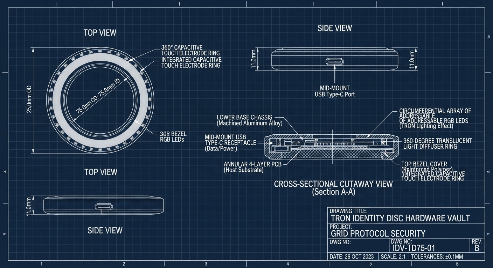

# Defensive Thesis: Why Identity Disc Vault is NOT "Just Another Hardware Key"

> **The Skeptic's Challenge**:  
> *"Isn't this just another hardware key? YubiKey, SoloKey, and Nitrokey already exist. We already have 1Password, Bitwarden, and HashiCorp Vault. Why does the world need Identity Disc Vault?"*

---

## 1. The Category Error: Hardware Key vs. End-to-End Injection Engine

A hardware key (YubiKey, Nitrokey, Titan) is a **cryptographic peripheral**—an isolated cryptographic token implementing standards like FIDO2/U2F, PIV, and OpenPGP. It answers cryptographic challenges: *"Can you sign this nonce with private key $K$ after a physical touch?"*

**A hardware key does NOT:**
1. Inject environment variables into a running process.
2. Protect child process memory from being dumped or paged to swap.
3. Bridge local biometric/physical presence into cloud IAM federation (AWS STS, GCP WIF).
4. Provide ephemeral anonymous `/dev/fd/N` file descriptor redirection for config files.
5. Guarantee zero-byte disk exposure across developer workflows (`npm run dev`, `terraform apply`, `docker build`).

**Hardware keys are ingredients; Identity Disc Vault is the complete execution engine.**

```text
┌────────────────────────────────────────────────────────────────────────┐
│                   WHERE TODAY'S ECOSYSTEM FAILS                        │
└────────────────────────────────────────────────────────────────────────┘

[ YubiKey / Hardware Token ] 
             │ Authenticates (WebAuthn / OTP)
             ▼
[ Password / Secret Manager ] (1Password / Bitwarden / HashiCorp Vault)
             │ Decrypts credential to clipboard or `.env` / dotfile
             ▼
[ Developer Workstation Disk / Shell ] ──❌ CRITICAL FAILURE POINT ❌──
             │  • ~/.aws/credentials left on disk indefinitely
             │  • Plaintext `.env` read by malicious npm dependencies
             │  • Shell history records `export SECRET=...`
             ▼
[ Target Developer Process ] (`terraform apply`, `cargo run`, `docker`)
```

When you use a YubiKey with existing password managers, the tool decrypts the secret and **dumps it into a plaintext `.env` file, writes it to `~/.aws/credentials`, exports it to shell environment, or places it on the system clipboard.** 

The moment a secret touches disk or a persistent parent shell, your $60 hardware key becomes completely irrelevant. An infostealer malware (RedLine, Lumma, Atomic Stealer) or a compromised npm supply-chain package doesn't need to break your YubiKey—it simply reads the plaintext `.env` or memory space that the tool left behind.

---

## 2. The Five Pillars That Make Identity Disc Vault Unique

### Pillar 1: Zero-Disk In-Memory Subprocess Injection (`0-Byte Exposure`)
Existing secret managers are **storage vaults**. Identity Disc Vault is an **execution runtime**.
- `idvault` never outputs a secret to stdout, never dumps a `.env` file, and never modifies your parent shell.
- It launches the target command as an isolated child process (`idvault exec -- terraform apply`), passing decrypted secrets directly into the child process memory space or anonymous pipes (`/dev/fd/X`).
- When the child exits, the memory is purged using Rust's `zeroize` and pinned with `mlock` to ensure secrets are never written to macOS/Linux swap partitions or crash dumps.

### Pillar 2: Presence-Gated Privilege Execution (Just-In-Time Proof of Human)
A stolen laptop with an unlocked session allows any script, background cron, or rogue dependency to silently drain secrets from traditional secret managers or local caches.
- `idvault` enforces an explicit **Proof-of-Human Presence (UP) check** at the exact instant of privileged execution.
- Even if an attacker has remote shell access, they cannot run privileged operations because the cryptographic unseal operation physically waits for a biometric touch (Touch ID / Windows Hello) or capacitive tap on the Identity Disc.

### Pillar 3: Hardware Independence & "Zero Friction" Passkey Fallback
Traditional hardware-token systems force a painful dilemma: either buy every engineer an expensive $60 physical key and manage dongle logistics, or give up on hardware-backed security.
- `idvault` treats **Passkeys (Apple Secure Enclave, Windows Hello, Linux TPM)** and **Physical FIDO2 Keys** as first-class peers via the WebAuthn PRF (Pseudo-Random Function) extension.
- Every MacBook already contains an Apple Secure Enclave; every modern PC has a TPM and Windows Hello. Developers get hardware-isolated cryptography out of the box on day 1 with zero hardware purchases.
- For teams that want a dedicated physical artifact, our open-source, 3D-printable Tron Disc ($15 BoM) provides an audit-grade physical token with 360° visual LED state verification.

### Pillar 4: Attested Cloud Bootstrap (Killing Static Cloud Keys)
The #1 source of cloud breaches remains static, long-lived AWS IAM access keys (`AKIA...`) and GCP service account keys committed to git or stored in `~/.aws/credentials`.
- `idvault` eliminates static cloud credentials entirely.
- It leverages WebAuthn assertion signatures to mint short-lived OIDC tokens, exchanging them dynamically with **AWS STS (`AssumeRoleWithWebIdentity`)** or **GCP Workload Identity Federation**.
- Cloud IAM roles are assumed dynamically for minutes at a time, locked to verified human presence, with zero static keys existing anywhere.

### Pillar 5: Physical State Awareness (The 360° LED Telemetry Ring)
Software secret prompts are notoriously vulnerable to prompt injection, clickjacking, and background credential harvesting.

<p align="center">
  
</p>

- When realized with the 3D-printable Identity Disc hardware, the physical device provides an unambiguous, out-of-band visual state indicator:
  - 🔵 **Cyan Pulse**: Disc armed in zero-trust standby; unsealed memory zeroed.
  - 🟡 **Amber Strobe**: Active process presence challenge; physically requesting authorization for a specific action.
  - 🟢 **Green Flash**: Signature minted, ephemeral injection active in child memory.
  - 🔴 **Red Flare**: Signature challenge rejected or timeout expired.
- Attackers cannot spoof physical hardware LED channels from a background script.

---

## 3. Comprehensive Competitive Matrix

| Feature / Threat Vector | Standard FIDO2 / YubiKey | 1Password / Vault CLI | Infisical / Doppler | Identity Disc Vault (`idvault`) |
| :--- | :---: | :---: | :---: | :---: |
| **Physical Human Presence Check** | ✅ Yes (Touch) | ⚠️ Master Password / Biometric Unlock Cache | ❌ No (API Key / Service Token) | ✅ **Yes (Hardware Touch / Secure Enclave)** |
| **Disk Exposure of Secrets** | ❌ N/A (Doesn't handle envs) | ❌ Writes `.env` / dotfiles / mounts | ❌ Injects to shell or writes files | 🛡️ **Guaranteed 0 Bytes (Strict RAM only)** |
| **Memory Isolation (`mlock`, Anti-Swap)** | ❌ No | ⚠️ Partial | ❌ No | 🛡️ **Enforced `mlock` + `MADV_DONTDUMP` + `zeroize`** |
| **Passkey / Secure Enclave Native** | ❌ Dongle Only | ⚠️ Software Passkey | ❌ Cloud Only | 🛡️ **Native OS WebAuthn PRF + FIDO2 Peer Support** |
| **Anonymous Pipe Injection (`/dev/fd/X`)** | ❌ No | ❌ No | ❌ No | 🛡️ **Built-in for file-based secrets** |
| **Ephemeral Cloud STS Federation** | ❌ Requires custom wrapper | ❌ No | ⚠️ Requires hosted cloud SaaS | 🛡️ **Direct WebAuthn-to-AWS/GCP STS Token Minting** |
| **Hardware Realization Cost** | $50 - $90 / key | SaaS Subscription ($$$) | SaaS Subscription ($$$) | **$0 (Native Passkey) or ~$15 (Open-Source Hardware Disc)** |
| **Visual Out-of-Band State Feedback** | ⚠️ Tiny blinking LED | ❌ Screen prompt only | ❌ None | 🛡️ **360° Neopixel telemetry ring** |

---

## 4. Summary: The Value Proposition

> **Identity Disc Vault is not a peripheral. It is the missing zero-trust runtime between hardware cryptography and developer process execution.**

It bridges the fatal chasm between authentication and execution:
1. It stops treating credentials as text files to be copied.
2. It treats secrets as transient, short-lived energy that exists only inside child process memory while a verified human is present.
3. It makes enterprise-grade hardware attestation accessible to any developer with a MacBook or PC without requiring a procurement order for proprietary hardware keys.
