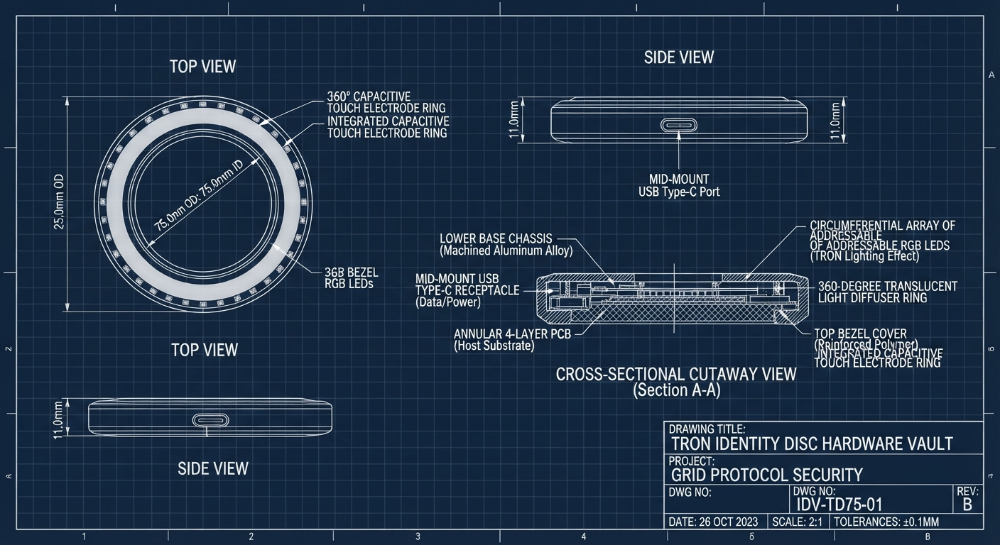

# Hardware Engineering & Bill of Materials (BoM)
## Identity Disc Hardware Vault (Rev 1.0)

This document specifies the physical architecture, mechanical stack-up, bill of materials (BoM), and 3D printing guide for the **Identity Disc Vault**.

---

## 1. System Overview & Physical Specs

  

- **Form Factor**: Annular Tron Identity Disc (pocket/keychain or desktop dock).
- **Dimensions**:
  - Outer Diameter (OD): **75.0 mm** (convenient hand/palm fit).
  - Inner Aperture (ID): **25.0 mm** (fits carabiner/lanyard loop or indexing dock pin).
  - Total Enclosure Height / Thickness: **11.0 mm**.
- **Mass**: ~45g (including PCB and hardware).
- **Primary Connectivity**: USB 2.0 Full-Speed via mid-mount USB Type-C receptacle (native USB HID / CTAP2.1).
- **User Presence Verification**: Capacitive Touch Electrode ring beneath top bezel.
- **Visual Feedback**: 360° neon diffusion ring driven by 16 circular WS2812B addressable LEDs (pulsing cyan for standby, amber for presence challenge, green for successful assertion, red for rejection).

---

## 2. Bill of Materials (BoM)

### 2.1 Electronics & Active Components (Estimated Qty: 1 prototype)

| Item | Component | Manufacturer / P/N | Description | Qty | Unit Cost (USD) | Source / Notes |
|:---:|:---|:---|:---|:---:|:---:|:---|
| **U1** | **ESP32-S3-MINI-1-N8** | Espressif Systems | Dual-core Xtensa 240MHz, 8MB Flash, Native USB OTG/HID, Hardware Crypto (AES, SHA, RSA, ECC) | 1 | $2.85 | Mouser / DigiKey / LCSC |
| **U2** | **ATECC608B-TNGTLS** | Microchip | Hardware Secure Element (ECDSA P-256, FIDO2 CTAP2 Authenticator Seed, Monotonic Counters) | 1 | $1.20 | Mouser / DigiKey |
| **U3** | **AP2112K-3.3TRG1** | Diodes Inc. | 3.3V 600mA Low-Dropout (LDO) Linear Voltage Regulator (SOT-23-5) | 1 | $0.35 | DigiKey / LCSC |
| **J1** | **TYPE-C-31-M-12** | Korean Hroparts Elec | 16-Pin Mid-Mount USB Type-C Receptacle (SMD + DIP hybrid) | 1 | $0.45 | LCSC (Mid-mount lowers z-height) |
| **D1-D16**| **WS2812B-2020** | Worldsemi | 2.0x2.0mm Addressable RGB LED (Circumferential array) | 16 | $0.08 ($1.28) | LCSC / Adafruit |
| **D17** | **USBLC6-2SC6** | STMicroelectronics | Ultra-low capacitance ESD protection array for USB lines (SOT-23-6) | 1 | $0.28 | Mouser / DigiKey |
| **TP1** | **Capacitive Touch Pad** | Custom PCB layer | Annular copper trace layer routed to ESP32-S3 `TOUCH1` / `TOUCH2` pins | 1 | $0.00 | Integrated into PCB top copper |
| **PASS**| Passives (0603/0402) | Various | Decoupling caps (10uF, 1uF, 100nF), 5.1k CC pull-downs, 27R USB D+/D- | 1 Set | $0.80 | Standard SMD passives |
| **PCB** | **Annular 4-Layer PCB** | JLCPCB / PCBWay | FR-4, 1.2mm thickness, ENIG gold finish, Matte Black solder mask | 1 | $4.00 (batch) | Circular router cut with Ø25mm center hole |

**Subtotal (Electronics)**: **~$11.21**

---

### 2.2 Mechanical & Enclosure Hardware

| Item | Part / Material | Spec / Dimensions | Function | Qty | Unit Cost (USD) | Notes |
|:---:|:---|:---|:---|:---:|:---:|:---|
| **M1** | **Lower Base Chassis** | 3D Printed PETG / Resin | Bottom tray with internal PCB seating, ribs, and USB cut-out | 1 | ~$1.20 (filament) | Model: `identity_disc_base.stl` |
| **M2** | **Light Diffuser Ring** | 3D Printed Translucent PETG / Frosted Acrylic | 360° light guide scattering LED light around the perimeter | 1 | ~$0.60 (filament) | Model: `identity_disc_light_ring.stl` |
| **M3** | **Top Bezel Lid** | 3D Printed Matte Black PETG | Top face with flush tactile surface and capacitive touch aperture | 1 | ~$1.00 (filament) | Model: `identity_disc_top_cover.stl` |
| **H1** | **Threaded Brass Inserts** | M2 x 3.0mm (OD 3.2mm) | Heat-set brass inserts installed into lower chassis bosses | 4 | $0.15 ($0.60) | CNC Kitchen / McMaster |
| **H2** | **Torx Machine Screws** | M2 x 4.0mm Stainless (Black Zinc) | Fastens top bezel into brass inserts | 4 | $0.10 ($0.40) | Flat or countersunk head |
| **H3** | **Bumpon Rubber Feet** | 3M Clear Polyurethane (4mm Ø) | Non-slip pads on base | 3 | $0.10 ($0.30) | Optional desktop grip |

**Subtotal (Mechanical)**: **~$4.10**

**Total BOM Estimate per Prototype Unit**: **~$15.31**

---

## 3. 3D CAD Design & Fabrication Guide

### 3.1 Provided CAD Files
Located in [`hardware/cad/`](file:///Users/bill/src/research/systems-programming/indentity-disc-vault/hardware/cad/):
1. **`identity_disc_base.stl`** / **`.obj`**: Lower chassis tray with mounting bosses and mid-mount USB-C clearance slot.
2. **`identity_disc_top_cover.stl`** / **`.obj`**: Top cover disc with inner bevel and capacitive touch landing.
3. **`identity_disc_light_ring.stl`** / **`.obj`**: 360° neon ring diffuser (print in translucent clear / frosted filament).
4. **`identity_disc_assembly.stl`** / **`.obj`**: Complete joined 3D model demonstrating full stack-up.
5. **`generate_cad.py`**: Parametric Python script to re-generate STL and OBJ files at arbitrary tolerances and dimensions.

### 3.2 3D Printing Recommendations
- **Technology**: FDM (Prusa MK4, Bambu Lab X1C) or SLA/MSLA (Elegoo Saturn, Formlabs).
- **Materials**:
  - **Base & Top Lid**: Matte Black PETG, Carbon-fiber PETG, or Black Tough Resin (0.12mm - 0.16mm layer height).
  - **Light Ring Diffuser**: Clear / Natural Translucent PETG (100% infill, concentric lines) or Frosted Semi-translucent SLA resin.
- **Assembly Steps**:
  1. Heat-press 4x M2 brass inserts into the cylindrical standoffs in `identity_disc_base`.
  2. Insert assembled PCB into base; align USB Type-C port into the rear cutout.
  3. Snap the translucent `identity_disc_light_ring` over the perimeter ledge.
  4. Place `identity_disc_top_cover` and fasten with 4x M2 screws from the underside.

---

## 4. Firmware Architecture (FIDO2 / WebAuthn PRF)

- **Firmware Framework**: Bare-metal Rust (`esp-idf-template` or `embassy-rs` on ESP32-S3).
- **USB Protocol**: Custom USB composite device:
  - **Interface 0: CTAP2 HID** (Usage Page `0xF1D0`, Usage `0x01`).
  - **Supported CTAP Extensions**: `hmac-secret` (CTAP2.1) and WebAuthn PRF.
- **Key Generation & Storage**:
  - Vault private master seed is either locked in the ATECC608B hardware enclave or protected by the ESP32-S3's hardware eFuse flash encryption and secure boot.
- **User Presence Verification**:
  - Hardware capacitive touch sensing triggers the FIDO2 User Presence (UP) flag.
  - Light ring pulses amber awaiting touch; snaps to solid cyan/white when touched and verified.
